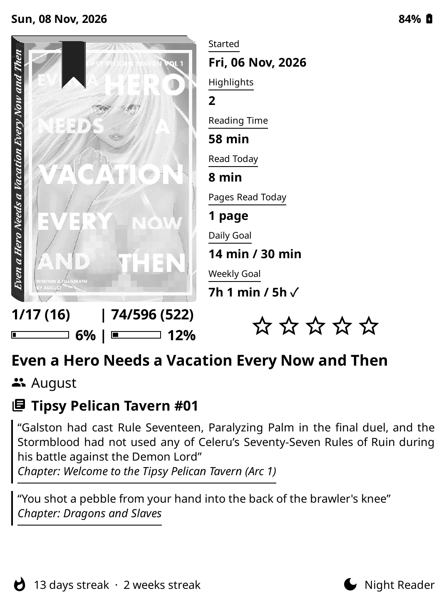
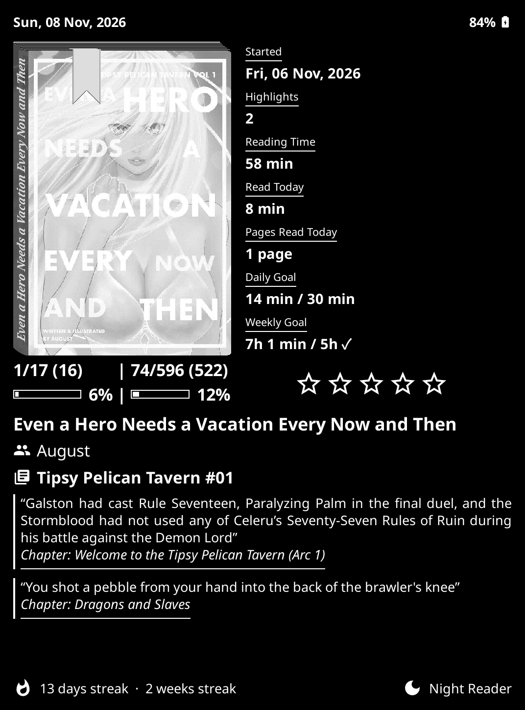

# Spined Card

A fork of **[Book card](https://github.com/peterboda236/bookcard.koplugin)** — the KOReader sleep screen that shows a reading summary card — with a redesigned card layout, a two-line progress strip, a star rating, multi-quote highlights with chapter lines, and a **"real book" cover** (spine, page stack and a progress ribbon bookmark) ported from two KOReader user patches.

<p align="center">
    
    
</p>

> **Status:** developed iteratively with an AI assistant (Claude) and tested on a Kindle. It has not been run on every device or KOReader version. Reports are welcome.

---

## Contents

1. [Parent projects and credits](#parent-projects-and-credits)
2. [Installation](#installation)
3. [Using it](#using-it)
4. [What this fork adds, changes and removes (summary)](#what-this-fork-adds-changes-and-removes-summary)
5. [Feature guide](#feature-guide)
6. [Settings reference](#settings-reference)
7. [Detailed comparison with each parent](#detailed-comparison-with-each-parent)
8. [Known limitations](#known-limitations)
9. [Updating](#updating)
10. [License](#license)

---

## Parent projects and credits

This project combines three upstream projects. All credit for the ideas, drawing code and base architecture belongs to their authors.

| Parent | Author | License | What it contributes here |
|---|---|---|---|
| [**bookcard.koplugin**](https://github.com/peterboda236/bookcard.koplugin) | peterboda236 | GPL-3.0 | The whole plugin: sleep screen, card layout, statistics, colours, fonts, wallpaper support, settings menu, updater, translations. **This repo is a fork of it.** |
| [**2-real-books.lua**](https://github.com/ReaLx3m/KOReader-AI-Slop-User-Patches/blob/main/2-real-books.lua) in [KOReader-AI-Slop-User-Patches](https://github.com/ReaLx3m/KOReader-AI-Slop-User-Patches) | ReaLx3m | AGPL-3.0 | The "real book" look: the spine with the sheared label, the stack of page lines that grows with page count, the rounded corners, and the cover-shape / page-line / font options. |
| [**KOReader-Progress-Bookmarks**](https://github.com/3lementa1/KOReader-Progress-Bookmarks) (`2-bookshelf-progress-bookmark.lua`) | 3lementa1 | GPL-3.0 | The progress **ribbon bookmark** that hangs over the cover and tracks reading progress. |

The parents have their own acknowledgements, which carry over:

- **Book card** credits: the idea comes from the statistics page of *crosspoint-reader*; statistics are based on *quanganhdo/koreader-user-patches*; the colour wheel comes from *Euphoriyy/KOReader.patches*; the in-plugin updater, cover shadows and overlook come from *AndyHazz/bookshelf.koplugin*.
- **Progress Bookmarks** credits: *Project: Title* by joshuacant; the *Real Books* patch by ReaLx3m; *Bookshelf* by AndyHazz.
- **Real Books** (ReaLx3m's patch) links joshuacant's guide for Calibre page counts.

> The two patches were written for the **file browser / Bookshelf grid**. They are **not** included as patches here: their *drawing code* was re-implemented in `lib/realbook.lua` to draw one book onto the sleep-screen card. See [the detailed comparison](#detailed-comparison-with-each-parent) for exactly what was and was not taken.

---

## Installation

1. Download the latest `bookcard.koplugin.zip` from the **[Releases](https://github.com/FahdiiiG/spinedcard.koplugin/releases)** page.
2. Unzip it. You get one folder named `bookcard.koplugin`.
3. Copy that folder to `koreader/plugins/` on your device.
4. Restart KOReader.

**Important:** the plugin folder keeps the name `bookcard.koplugin`, exactly like the original. This fork **replaces** the original Book card — you cannot have both installed at once. Your existing Book card settings carry over, because the setting names are unchanged.

If you currently use the original, remove (or overwrite) `koreader/plugins/bookcard.koplugin` first.

Android note (inherited from the original): KOReader's own sleep screen only appears on platforms where KOReader owns the "device is asleep" screen (for example Kindle, Kobo). On Android, locking hands control to Android's lock screen, so the sleep screen is not shown.

---

## Using it

- **Set as sleep screen:** Settings → Screen → Sleep screen → Wallpaper → **Book card** (or Tools → Book card → *Use as sleep screen*).
- Locking **from inside a book** uses live data and refreshes the cache. Locking **from the file manager** uses data cached from the last book you had open; if there is no cache it is rebuilt from the book's sidecar and the statistics database.
- All settings are under **Tools → Book card**. The new options are mostly in **Card elements**.
- You can assign a gesture to open the menu.

---

## What this fork adds, changes and removes (summary)

### Added
- **Real book cover**: a spine with the book's name, a stack of page lines that grows with page count (2–12 lines), a rounded-corner cover edge and an optional progress ribbon — with a full options menu.
- **Progress ribbon bookmark** that moves along the page stack and across the cover with your reading progress.
- **Two-line progress strip** under the cover: chapter pages read / total | book pages read / total, then a chapter bar and a book bar with percentages.
- **Star rating** (KOReader's 1–5 stars) drawn as icons beside the strip.
- **Several highlighted quotes at once**, filling the space you reserve, shown in reading order, each with its own left bar and an italic, underlined **chapter line**.
- **Quote line limit up to 10** (quick picks 1–5 plus *Custom*).
- **Reserved quote space**: the cover and other elements are sized once for the line count you choose and do not move whether or not the book has a quote.
- **Shrink-to-fit** text for the stats column, strip, author and series lines (via new exact-size font helpers).
- **Progress bar inside the Progress stat.**
- **New icons**: `authors`, `series`, `star`, `star_outline`.
- **Night-mode awareness** for everything new (cover stays natural, the rest follows the theme), plus a dedicated dark-card spine and edge.

### Changed
- Stat cells: **underlined label on top, value below, left-aligned** (the original was value on top, label below, right-aligned).
- **Started** stat: label `Started`, value = full date (`Sat, 07 Nov, 2026`).
- **Top row**: date on the left; battery on the right as `80% <glyph>` (percentage first).
- **Side layout**: title / author / series / quotes form one block across the **full card width** below the cover and strip; the stats column sits beside the cover and ends level with the strip.
- Title wraps to 2 lines (side layout) or 4 (centered layout), justified.
- Authors and series are forced onto **one line**, shrinking to fit, with icons.
- Series index is zero-padded (`#01`, `#00.70`).
- Quote text now uses the **regular** font by default (was italic) and is justified.
- Stat grid (centered layout) uses the same underlined-label style, bigger row gaps and bars.

### Removed
- The relative **Today / Yesterday / N days ago** value of the Started stat.
- The `Started {date}` label variant.
- The translatable series template `{series} / #{index}` (replaced by a fixed `Series #01` format — see [Known limitations](#known-limitations)).
- The 5-line cap on quotes (now 10).
- Right-aligned stat cells.

---

## Feature guide

### Top row
The date (e.g. `Sat, 07 Nov, 2026`) sits at the top left. The battery sits at the top right as the percentage followed by KOReader's own battery glyph. Both use the **battery** font and colour settings. The battery can still be switched off under *Card elements → Show battery*.

### Statistics cells
Each statistic shows an **underlined label** with the **value underneath**, left-aligned. The **Progress** stat additionally shows a thin outlined bar under its value. In the side layout the column starts level with the top of the cover and ends level with the bottom of the progress strip (or the cover, if the strip is off). If the rows do not fit, the stat fonts shrink in 5 % steps until they do, and any slack is spread evenly between rows. The column sits a fixed small distance to the right of the cover. All existing statistic options (show/hide, order, separators, reading goals) are unchanged.

**Started** now reads: label `Started`, value `Sat, 07 Nov, 2026` (same format as the top-row date).

### Progress strip (side layout only)
A two-line block exactly as wide as the cover, directly under it:

```
62/516 (454)   |   62/516 (454)        chapter  |  book      pages read / total (pages left)
[=====    ] 12%|   [==       ] 12%      chapter bar + %  |  book bar + %
```

- **Line 1:** pages read / total (and pages left in brackets) for the **chapter** (left) and the **book** (right).
- **Line 2:** a chapter bar with percentage and a book bar with percentage.
- Chapter figures come from the book's table of contents (live document only). If the book has no usable table of contents, or the card was built from cache, the chapter side shows the book's numbers instead.
- The current page counts as read.
- The font is the bold stat-value font and **shrinks automatically** until both page counts fit their half of the cover width.
- Toggle: **Card elements → Show progress under cover** (default on). Not used in the centered layout.

### Star rating (side layout only)
KOReader's own 1–5 star rating for the book (the one you set in the book's status/summary) is shown as **five star icons** — filled up to the rating, outlined for the rest. A book with no rating shows five outline stars. There is no heading. The stars sit in the same row as the progress strip, in the box to its right (up to the card's right margin), **centred horizontally and vertically** in that box. They are SVG icons (so no font needs star glyphs), follow the light/dark theme, and scale with the strip and with any text shrinking, never taller than the strip.
Toggle: **Card elements → Show rating** (default on).

### Title, author and series
- **Title:** justified; up to 2 lines in the side layout (4 in the centered layout), then an ellipsis.
- **Author(s):** always one line, with an *authors* icon; the font shrinks one step at a time (down to size 3) until icon and text fit — no ellipsis.
- **Series:** always one line, with a *series* icon, same shrink rule. The index is zero-padded: `Series Name #01`; fractional indexes become `#00.70`. If the icons fail to load the text still shows.

### Highlighted quotes
Under **Card elements → Highlighted quote**: *Show quote* (off by default, as in the original) and *Maximum lines*.

- **Maximum lines:** quick picks **1–5**, plus **Custom (1–10)**. Anything above 10 is saved as 10; below 1 becomes 1. A previously saved value is honoured.
- **How quotes are chosen:** the book's highlights are collected into a pool of up to 25 in random order. The card measures each at the real width and tries 40 random combinations, keeping the one that leaves the fewest empty lines inside your chosen number of lines. Only **whole quotes** go in a combination, so when several quotes are shown none ends in "…".
- **If no single quote fits** your limit, one quote is shown, cut off with "…" on its last line. No quote is ever dropped just because of lack of room.
- **Reading order:** when several are shown they are ordered by position in the book (earliest first).
- **Layout:** each quote has its own left bar, with a gap between quotes. Quote text is regular (not italic) and justified.
- **Re-picked** every time the card is built, so the selection changes between sleeps.
- **Reserved space (side layout):** with *Show quote* on, the cover, strip, stats, rating and title block are sized to always leave room for exactly the number of lines you picked (+ the gap above), whether or not the book has quotes. Choosing 8 reserves 8 lines; only 10 reserves 10. With *Show quote* off nothing is reserved. If there is still not enough room below the title block, the quote is rebuilt with fewer lines (at least one). In the **centered** layout the quote still shrinks the cover as in the original.

### Chapter line
Under each quote, one line reading `Chapter: <name>`, in **italic**, **underlined**, in the same quote colour, sharing the quote's left bar.
- The chapter **name** comes from the highlight itself. **No chapter number is shown** — a leading `Chapter 7 -`, `7.` or `Chapter 07:` is stripped from the name. If a title is nothing but a number it is shown as it is (`Chapter: 7`).
- It takes about one extra line of the quote space, which is counted when the combination of quotes is chosen.
- It is skipped when the line limit is 1 (no room).
- The label shrinks to fit rather than ending in "…".
- The text box is slightly taller than the glyphs so the tails of italic letters (the "p" in "Chapter") are not clipped.

### Real book cover
A new option under **Card elements → Real book cover** (on by default). The cover is drawn like a physical book:

- A **spine** on the left carrying the book's name running up it, sheared slightly ("seen from the side") with angled ends. The spine is tinted by the cover's own left strip.
- A **stack of page lines** above the cover: more lines for longer books (see tiers below). Unknown page count → 4 lines.
- A **cover edge** along the top, right and bottom (see below) with rounded right corners.
- An optional **progress ribbon**.

The book is drawn once into a bitmap and shown like any other cover. It is sized to the cover's box, so the whole book — spine included — takes the cover's width and height, and the progress strip underneath is as wide as the whole book. If the cover is missing or drawing fails, you get the normal cover. The cover drop shadow is not drawn on the real-book cover. Over a wallpaper the book sits on a rectangle in the card's background colour.

#### Cover edge
The plain black outline of earlier versions (which turned **white in night mode**) was replaced by a configurable **board edge** along the top, right and bottom of the cover:
- **Off** — no edge; the corners are still rounded.
- **Thin** — as thick as a page line.
- **Thick** (default) — **twice** as thick as a page line.
- The edge is painted as a **grey whose *displayed* brightness is the setting**, so it never becomes a hard black line on a light card nor a white one in night mode: *Light card: edge brightness* (default 20 %, 0–60 %) and *Dark card: edge brightness* (default 45 %, 20–80 %).

#### Page-line tiers
Page count decides how many lines are drawn. Tiers 2–12 are all on by default; tier *N* covers books up to the page count shown, the last tier everything above:

| Lines | Up to pages (default) |
|---|---|
| 2 | 100 |
| 3 | 200 |
| 4 | 350 |
| 5 | 500 |
| 6 | 700 |
| 7 | 1000 |
| 8 | 2000 |
| 9 | 4000 |
| 10 | 7000 |
| 11 | 12000 |
| 12 | above 12000 (sized for books up to ~25,000 pages) |

Each tier can be switched off (2 lines is the always-on floor), and each page limit can be set from 10 to 25,000 (long-press the spinner to move in steps of 500).

#### Progress ribbon
A ribbon hangs over the cover from the page stack. Its height up the stack and its position across the page follow your reading progress. Options: show/hide; tracking (along the page and up the stack / along the page only / up the stack only); thickness (thin / medium / thick / **custom 2–40 % of cover width**); length (short / medium / long); colour (default / lighter / darker); edge highlights; and how **finished** books (half ribbon at the start — default, full at the start, full at the end, half at the end, none) and **unopened** books (none — default, half, full) are shown.

#### Night mode
- **Follow night mode** (on by default): everything except the cover inverts with night mode — spine, page lines, edge and ribbon — and the cover stays natural. A forced light/dark **Background** setting is respected too. Turning it off makes the whole book look the same in night mode.
- On a **dark card** (night mode or forced dark) the spine becomes **dark grey with off-white text** instead of the inverted day look, so it differs from the light card and is soft on e-ink. Defaults: spine brightness 20 %, text brightness 88 %.
- The stars, author/series icons, progress strip and chapter line also follow the theme.

---

## Settings reference

All paths start at **Tools → Book card**. "Default" is the out-of-the-box value.

### Card elements
| Setting | Default | Notes |
|---|---|---|
| Show battery | on | Percentage then glyph, top right |
| Show reading streak | on | unchanged |
| Show reader type | on | unchanged |
| **Show progress under cover** | on | New. Two-line strip, side layout only |
| **Show rating** | on | New. Five stars, side layout only |
| **Real book cover** | on | New. Submenu — see below |
| Highlighted quote → Show quote | off | |
| Highlighted quote → **Maximum lines** | 2 | 1–5 quick picks + **Custom (1–10)**; >10 becomes 10 |
| Statistics rows | — | unchanged (show/hide, order, separators, reading goals). Rating is **not** a stats row |

### Card elements → Real book cover
| Group | Setting | Default | Range / choices |
|---|---|---|---|
| (top) | Real book cover on/off | on | |
| (top) | Follow night mode | on | |
| Spine | Spine width | 100 % | 100–200 % |
| Spine | Spine text | Title | Title · Author - Title · Title - Author · File name |
| Spine | Font face | Noto Serif Bold Italic | 21 faces: Noto Serif/Sans (regular, bold, italic, bold italic), Free Serif/Sans, Droid Sans Mono, Noto Naskh Arabic, Noto Sans Arabic UI, Bengali UI, CJK SC, Devanagari UI, Symbols |
| Spine | Font size | 16 | 10–24 |
| Spine | Text lean | 30 % | 0–100 % |
| Spine | Label opacity | 80 % | 0–100 % |
| Spine | Dark card: spine brightness | 20 % | 0–60 % |
| Spine | Dark card: text brightness | 88 % | 40–100 % |
| Spine | Text style | white on black | or black on white |
| Spine | Text direction | up | or down |
| Cover shape | Cover size | 100 % | 50–100 % |
| Cover shape | Aspect ratio | off | force 2:3 · 3:4 · 9:16 · 1:1 · 3:2, or custom width/height (1–20) |
| Cover shape | **Cover edge** | Thick | Off · Thin · Thick |
| Cover shape | Edge brightness (light card) | 20 % | 0–60 % |
| Cover shape | Edge brightness (dark card) | 45 % | 20–80 % |
| Page lines | Line thickness | 2 px | 1–5 |
| Page lines | Line spacing | 1 px | 0–5 |
| Page lines | Line length | 102 % of cover width | 10–150 % |
| Page lines | Line colour | Gray 9 | 11 greys, Gray 1 (darkest) … Light gray |
| Page lines | Show line tiers | all on | 2 lines is the floor |
| Page lines | Pages per tier | see table above | 10–25,000 |
| Progress bookmark | Show progress bookmark | on | |
| Progress bookmark | Tracking | both | both · along the page · up the stack |
| Progress bookmark | Thickness | Thick | Thin · Medium · Thick · Custom (2–40 % of cover) |
| Progress bookmark | Length | Short | Short · Medium · Long |
| Progress bookmark | Colour | Default | Default · Lighter · Darker |
| Progress bookmark | Edge highlights | on | |
| Progress bookmark | Finished books | half ribbon at start | start (half/full) · end (half/full) · none |
| Progress bookmark | Unopened books | none | none · half · full |

### Stored setting names
Prefixes: `bookcard_show_progress_strip`, `bookcard_show_rating`, `bookcard_real_book`, `bookcard_spine_text`, `bookcard_quote_max_lines`, and `bookcard_rb_*` for every Real-book option (e.g. `bookcard_rb_edge_style`).

---

## Detailed comparison with each parent

### vs. Book card (peterboda236)
**Everything not listed here is unchanged** — including the settings menu structure, colours, fonts, wallpaper support, cache, PNG export, reading goals, translations, gestures, the About screen and the updater.

*Files changed:* `main.lua`, `lib/bookdata.lua`, `lib/fonts.lua`, `views/card_view.lua`, `widgets/statcell.lua`, `lib/updater.lua` (repository), `views/about.lua` (repository link), `_meta.lua` (version).
*Files added:* `lib/realbook.lua`, `icons/authors.svg`, `icons/series.svg`, `icons/star.svg`, `icons/star_outline.svg`.

| Area | Original | This fork |
|---|---|---|
| Stat cell | Value on top, label below, right-aligned | Underlined label on top, value below, left-aligned; optional bar |
| Progress stat | Text only | Text + outlined bar |
| Started stat | `Today` / `Yesterday` / `N days ago` over `Started {date}` | `Started` over `Sat, 07 Nov, 2026` |
| Top row | Battery only (`glyph 80%`) | Date at left; battery at right as `80% glyph` |
| Side layout | Title block below the cover, no wider than the cover | One full-width block below cover + strip |
| Stats column | Right-aligned against the right margin | Left-aligned, beside the cover, level with cover and strip; shrinks to fit |
| Title | 2 lines | 2 lines (side) / 4 lines (centered), justified |
| Author | One text line, may be cut | One line with icon, shrinks to fit |
| Series | `{series} / #{index}` template via gettext | `Series #01` with icon, shrinks to fit |
| Quote font | Italic | Regular (the plain default only — a font you chose yourself is kept) |
| Quote | One random quote, max 1–5 lines | Several whole quotes, 1–10 lines, reading order, chapter lines, reserved space |
| Cover | Plain framed cover | Optional real-book cover |
| Progress | Right-hand stats only | Plus two-line strip under the cover |
| Rating | — | Five stars |
| Fonts module | `getFace` ignores sizes whenever a size exists | New helpers `getUnitSize`, `getFaceAt`, `getFaceByName` for exact-size, shrinkable faces |
| Data (`bookdata.lua`) | One quote, no rating, no chapter data | Quote pool with chapters and positions, rating, chapter pages read/total |
| Updater / About | Point to the original repository | Point to this repository |

### vs. 2-real-books.lua (ReaLx3m)
**Taken (re-implemented for one card):** the spine geometry and shear, the angled spine ends, the sheared/rotated label drawn over the cover's own left strip, label text modes, the font-face list, the stack of page lines with page-count tiers, page-line colour/length/thickness/spacing, rounded right corners, cover scale and forced aspect ratio, spine width multiplier.

**Changed:**
- Drawn **once to a bitmap** for the card, not onto a file-browser grid.
- Page tiers extended to **2–12 lines** with new defaults (original defaults enabled up to 6 lines, cover scale 95 %, default spine text *Filename*, default font Noto Serif). Here: all 12 tiers on, cover size 100 %, default spine text *Title*, default font Noto Serif Bold Italic.
- Pages-per-tier limit raised to 25,000.
- Settings live in **Card elements → Real book cover**, not "AI Slop Settings".
- **Night-mode handling** and a **dark-card spine** (new).
- The black outline became a configurable **cover edge** (new).

**Not taken:** the file-browser / mosaic integration, the "AI Slop Settings" menu, the *progress badge* (quarter-circle at the cover's corner — the card already shows progress), the file-size-based page estimate (the card has real page counts), the separate bold toggle and padding option, folder/other file-browser logic.

### vs. Progress Bookmarks (3lementa1)
**Taken:** the ribbon's drawing (shape, notch, edge highlights), horizontal / vertical / both tracking, thickness and length presets (85/100/135 % and 65/100/135 %), colour options, edge-highlight toggle, and the finished / unopened behaviours.

**Changed / added:** drawn on the sleep-screen cover; a **Custom thickness** (2–40 % of cover width); the ribbon follows night mode; defaults set to thick / short / both.

**Not taken:** the Bookshelf integration, Cover View / Spine View separation and per-view settings, spine-text options for Bookshelf's spine view (series index, wrapping, font matching), bindings presets, the page-line count/binding controls (replaced by the ReaLx3m tiers), and the patch's own update checker.

---

## Known limitations

- **Translations:** the new strings (for example "Show progress under cover", "Show rating", everything in "Real book cover") are not in any `.po` file yet, so they appear in English in every language. Pull requests with translations are welcome.
- **Series format:** the series line no longer goes through the translatable `{series} / #{index}` template, so a translated series template is ignored.
- **Chapter numbers:** none are shown by design.
- **Strip duplicates stats:** the strip's pages/percentage partly repeat the right-hand Progress and Pages statistics; turn the strip off if you prefer one or the other.
- **Side layout only:** the strip, rating and reserved quote space are side-layout features; the centered layout still sizes itself around the quote.
- **Tall quote reserves** (e.g. 10 lines) make the cover noticeably smaller; the stats column shrinks to match. Lower the limit for a bigger cover.
- **Chapter data** needs the book's table of contents and an open book; otherwise the chapter side repeats the book's numbers.
- **Not tested** on every device, firmware or KOReader version, or in e-ink "dark mode" panels other than the author's.
- **Real-book cover** has no drop shadow.

---

## Updating

**Tools → Book card → Updates** checks the latest release of **this** repository, exactly like the original's updater. A release must carry a `.zip` asset whose single top-level folder is `bookcard.koplugin`.

---

## License

This repository is a derivative work and is distributed under the **GNU General Public License v3.0** (see [`LICENSE`](LICENSE)), the license of the Book card plugin it forks. `lib/realbook.lua` is derived from `2-real-books.lua`, which is licensed under the **GNU Affero General Public License v3.0**; GPL-3.0 §13 and AGPL-3.0 §13 allow the two to be combined, and the AGPL's terms apply to that part of the combined work. The AGPL text is in [`LICENSES/AGPL-3.0.txt`](LICENSES/AGPL-3.0.txt). The Progress Bookmarks patch is GPL-3.0. Please keep these notices and the credits above when you reuse any of this code.

*This section is a good-faith summary, not legal advice.*

---

## Contributing and reporting problems

Issues and pull requests are welcome. When reporting a layout problem, please include the device, the KOReader version, your Card elements settings, and a photo of the card.
